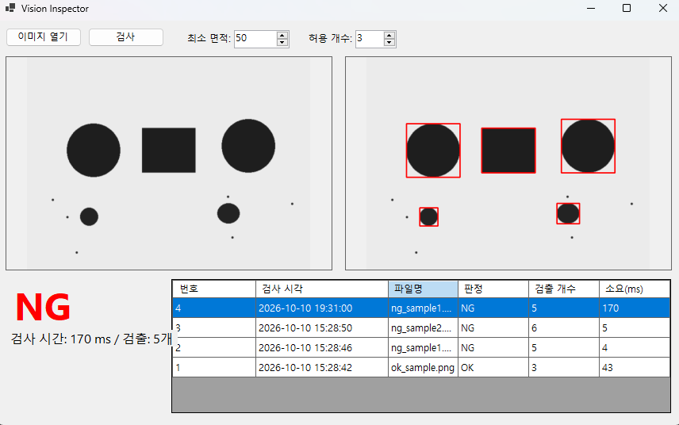
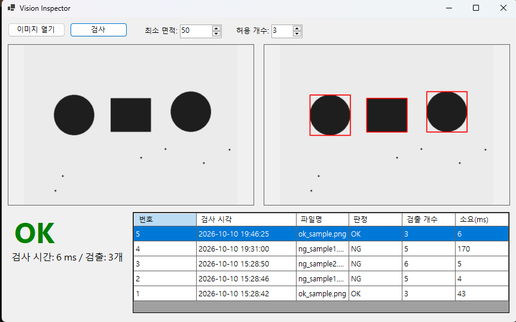
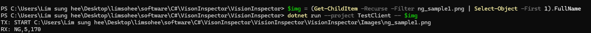
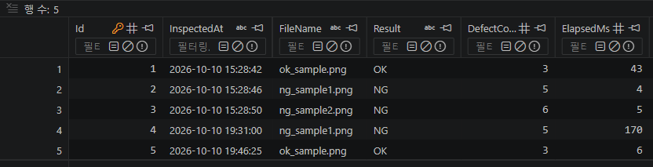

# Vision Inspector

C# WinForms + Emgu CV 기반 이미지 검사 프로그램.
이미지 검사, OK/NG 판정, 이력 저장, TCP 통신(검사 요청/응답)을 구현했습니다.

## 주요 기능
- 이미지 불러오기 및 원본/결과 표시
- 그레이스케일 → 가우시안 블러 → Otsu 이진화 → 윤곽선 검출 → 면적 필터 → 개수 기준 OK/NG 판정
- 최소 면적, 허용 개수를 화면에서 설정
- 검사 시간 측정 (Stopwatch)
- SQLite 이력 저장 및 DataGridView 조회
- TCP 서버: `START [이미지경로]` 수신 시 검사 후 `판정,검출개수,소요ms` 응답

## 구조
(UI) Form1 ── Inspect() ── Emgu CV
       ├── InspectionRepository ── SQLite
       └── TcpInspectionServer ◀── TestClient (콘솔)

## 통신 프로토콜
| 요청 | 응답 |
|---|---|
| `START` / `START <경로>` | `OK,0,12` 또는 `NG,5,12` |
| 오류 | `ERROR,NO_IMAGE` / `ERROR,FILE_NOT_FOUND` / `ERROR,UNKNOWN_COMMAND` |

## 실행 방법
1. VisionInspector 실행 (포트 9000 대기)
2. `dotnet run --project TestClient -- "<이미지 경로>"`

## 스크린샷

## 스크린샷

### NG 판정 (빨간 박스 + 이력)

### OK 판정

### TCP 테스트 (TestClient)

### SQLite 저장 확인

## 배운 점 / 어려웠던 점
- TCP 수신 스레드에서 UI를 직접 건드릴 수 없어 Invoke로 UI 스레드에 넘김
- 버튼과 TCP가 같은 검사 함수(RunInspection)를 공유하도록 구조화
- 작은 노이즈는 면적 필터로 제거
